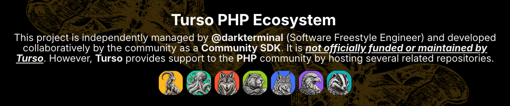
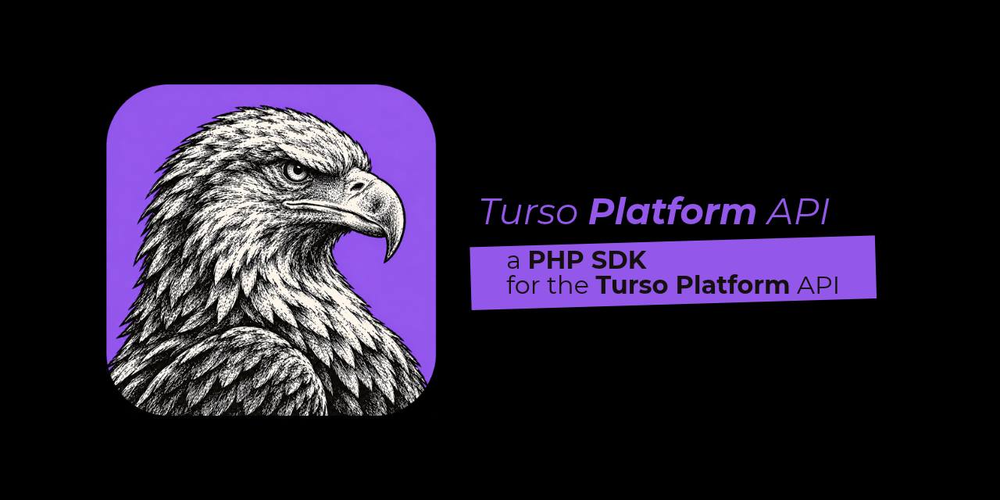

<p align="center">
  <a href="https://discord.gg/9eAaMnJtfY">
    
  </a>
</p>

<p align="center">
  
</p>

<p align="center">
  <a href="LICENSE"></a>
  <a href="https://discord.gg/9eAaMnJtfY"></a>
  <a href="#contributors"></a>
  <a href="https://packagist.org/packages/darkterminal/turso-api-client-php"></a>
  <a href="https://github.com/darkterminal/turso-api-client-php/tags"></a>
</p>

# Turso Platform PHP SDK

Typed PHP SDK for the **Turso Platform API** — the control plane behind [Turso](https://turso.tech) and [libSQL](https://turso.tech/libsql). It provides a resource-oriented client for managing organizations, databases, groups, tokens, members, invites, audit logs, recovery, and related platform operations from PHP.

This package is for **Platform API** automation. It is not a libSQL/Hrana database driver; use a database client for SQL/data-plane access after creating database tokens through this SDK.

## Documentation

- **Docs site / User manual**: [darkterminal.github.io/turso-api-client-php](https://darkterminal.github.io/turso-api-client-php/)
- **Getting started**: [User manual — Getting started](https://darkterminal.github.io/turso-api-client-php/user-manual/getting-started/)
- **API map**: [User manual — API map](https://darkterminal.github.io/turso-api-client-php/user-manual/reference/api-map/)
- **Repo docs**: [`docs/api-map.md`](docs/api-map.md), [`docs/architecture.md`](docs/architecture.md), [`docs/troubleshooting.md`](docs/troubleshooting.md)
- **Changelog**: [CHANGELOG.md](CHANGELOG.md)

## Requirements

| Component | Version |
|---|---|
| PHP | 8.3+ |
| ext-curl | required |
| ext-json | required |
| PSR-18 HTTP client | optional — SDK ships `CurlTransport` by default |

## Installation

```bash
composer require darkterminal/turso-api-client-php
```

## Quick start

```php
<?php

use Darkterminal\TursoPlatformAPI\Client\Client;

require __DIR__ . '/vendor/autoload.php';

$client = Client::builder()
    ->withToken($_ENV['TURSO_PLATFORM_API_TOKEN'])
    ->withOrganization('acme') // organization slug for org-scoped resources
    ->build();

$me = $client->user()->get();
$databases = $client->databases()->list();
```

### Builder configuration

| Method | Purpose |
|---|---|
| `withToken(string)` | Platform API Bearer token. |
| `withOrganization(string)` | Organization slug for v1/v2 org-scoped resources. |
| `withOrganizationId(string)` | Organization UUID for v3 recovery operations. |
| `withBaseUrl(string)` | Custom base URL (default `https://api.turso.tech`). |
| `withTimeout(int)` | Timeout in seconds (default `20`). |
| `withTransport(Psr\Http\Client\ClientInterface)` | Inject any PSR-18 client. |

## Resources

The SDK maps 53 operations from the pinned OpenAPI snapshot (`openapi/coverage-manifest.yaml`).

| Resource | Example methods |
|---|---|
| `user()` | `get()` |
| `auth()` | `validate()` |
| `locations()` | `list()` |
| `organizations()` | `list()`, `get()`, `update()`, `listPlans()`, `listInvoices()`, `getSubscription()`, `getUsage()` |
| `members()` | `list()`, `add()`, `get()`, `updateRole()`, `remove()` |
| `invites()` | `list()`, `create()`, `delete()` (v2) |
| `databases()` | `list()`, `create()`, `get()`, `delete()`, `getConfiguration()`, `updateConfiguration()`, `listInstances()`, `getInstance()`, `createToken()`, `invalidateTokens()`, `usage()`, `stats()` |
| `groups()` | `list()`, `create()`, `get()`, `delete()`, `getConfiguration()`, `updateConfiguration()`, `transfer()`, `unarchive()`, `addLocation()`, `removeLocation()`, `update()`, `createToken()`, `invalidateTokens()` |
| `apiTokens()` | `list()`, `create()`, `revoke()` |
| `organizationApiTokens()` | `list()`, `revoke()` |
| `auditLogs()` | `list(page, pageSize)` |
| `recovery()` | `listDeletedDatabases()`, `restoreDatabase()`, `listDeletedGroups()`, `restoreGroup()` (v3, requires `withOrganizationId()`) |

See the full [API map](https://darkterminal.github.io/turso-api-client-php/user-manual/reference/api-map/) for operation IDs, HTTP paths, and SDK methods.

## Integrations

Standalone integrations are separate from the default Platform API resource client:

| Integration | Purpose |
|---|---|
| `Integrations\DatabaseUploader` | Upload a local SQLite dump to a database created with `seed.type='database_upload'`. Performs preflight checks (WAL, `page_size=4096`, `auto_vacuum=0`, UTF-8) and requires a database-scoped token/JWT. |
| `Integrations\RegionResolver` | Read-only closest-region lookup via `https://region.turso.io/`; no Platform API auth required. |

```php
use Darkterminal\TursoPlatformAPI\Integrations\DatabaseUploader;
use Darkterminal\TursoPlatformAPI\Integrations\RegionResolver;

$uploader = new DatabaseUploader();
$uploader->uploadDump('dmpupload-....turso.io', $databaseJwt, '/path/to/dump.db');

$region = (new RegionResolver())->closest();
// ['server' => 'aws-us-west-2', 'client' => 'lax']
```

## Error handling

All SDK exceptions extend `PlatformException`.

| Case | Exception |
|---|---|
| Invalid config / missing org slug or org ID | `ConfigurationException` |
| Local input validation failure | `ValidationException` |
| Network/transport failure | `TransportException` |
| 401 / 403 | `AuthenticationException` |
| 404 | `NotFoundException` |
| 429 | `RateLimitException` (`retryAfter` when available) |
| 5xx | `ServerException` |
| Other non-2xx | `HttpException` |
| Decode/shape mismatch | `UnexpectedResponseException` |

Credentials are never reflected in exception messages.

## Testing

```bash
composer install
composer test
composer analyse
```

Current local suite: Pest, 78 tests / 167 assertions. PHPStan runs at level 6.

## Notes / scope

- **Platform API only** — no SQL/data-plane execution.
- **Laravel adapter** is out of scope for this package.
- **v3 recovery** requires `withOrganizationId()` (UUID), not only organization slug.
- **Contract quirks** (delete database envelope, empty 2xx bodies, upload preflight, etc.) are documented in [Troubleshooting](https://darkterminal.github.io/turso-api-client-php/user-manual/errors-troubleshooting/).

## Versioning

- Semantic Versioning. See [CHANGELOG.md](CHANGELOG.md).
- v2.x public API is the typed client built via `Client::builder()`.
- v1.x API was removed in v2.0.0; see migration notes in the changelog.

## Security

- Bearer token is attached only to configured Platform API requests.
- Default `CurlTransport` does not follow redirects.
- Org-scoped and v3 recovery operations fail fast with `ConfigurationException` when required configuration is missing.
- Report vulnerabilities privately via [GitHub Security Advisories](https://github.com/darkterminal/turso-api-client-php/security/advisories/new).

## Contributors

See the [contributor graph](https://github.com/darkterminal/turso-api-client-php/graphs/contributors).

## Contributing

Please see [CONTRIBUTING.md](CONTRIBUTING.md).

## License

MIT — see [LICENSE](LICENSE).
